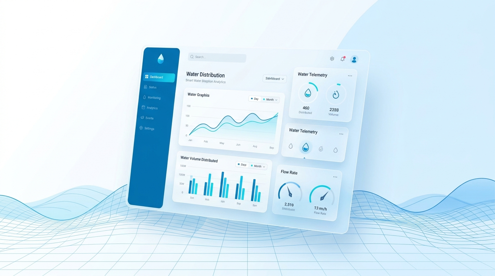
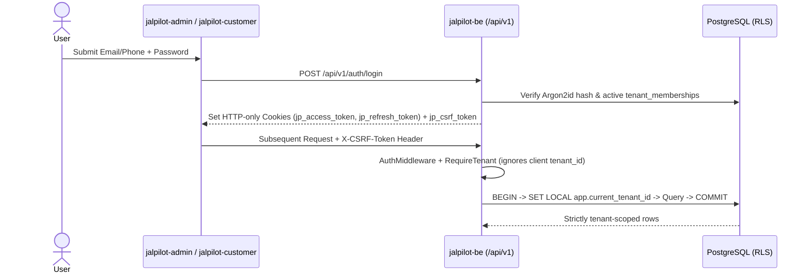

<div align="center">


<br/>

[](https://go.dev/)
[](https://gofiber.io/)
[](https://www.postgresql.org/)
[](https://redis.io/)
[](https://react.dev/)
[](https://www.typescriptlang.org/)
[](https://tailwindcss.com/)

**Smart Multi-Tenant Water Supply & Jar Delivery SaaS Platform**

*Replace paper registers with auditable ledgers, automated customer onboarding, staff delivery tracking, and dynamically themed customer portals.*

</div>

---



## Overview

**JalPilot** is a production-oriented, multi-tenant SaaS platform built for water supply and water jar delivery businesses. A single platform owner manages all water companies through a central **Super Admin Panel**, while every registered water company operates in an isolated workspace with its own **Company Admin Panel**, **Delivery Staff Portal**, and **Branded Customer Portal**.

### Key Capabilities

- **Strict Multi-Tenant Isolation**: Shared PostgreSQL database with `tenant_id` on all tenant-owned tables, composite foreign keys `(tenant_id, id)`, and transaction-local `FORCE ROW LEVEL SECURITY` (`SET LOCAL app.current_tenant_id`).
- **Automatic Customer Account Creation & Linking**: Adding a customer creates their business profile immediately (`INVITED`), dispatches a hashed invitation token, and links the verified login identity to the existing customer record without duplicates.
- **Immutable Financial Ledger**: Append-only `customer_ledger_entries` track water charges, bottle deposits, payments, and adjustments—never overwriting historical balances.
- **Dynamic Theme Marketplace**: Super Admins publish configuration-driven themes (`Aqua Professional`, `Ocean Premium`, `Fresh Aqua`, `Aqua Express`, `Pure Luxury`); Company Admins purchase and activate themes that apply dynamically to their Customer Portal without redeployment.
- **Leave & Delivery Pauses**: Customer leave requests automatically create `delivery_pauses` upon admin approval while preserving historical completed deliveries.

---

## Repository & Project Structure

JalPilot is organized into **three independent Git repositories** orchestrated from this root workspace:

```text
JalPilot/
├── Makefile                    # Unified orchestration (`make run`, `make build`, `make test`)
├── README.md                   # Platform overview & documentation
├── docs/assets/                # Hero banner & animated SVG assets
│
├── jalpilot-be/                # Go + Fiber Modular Monolith Backend
│   ├── cmd/
│   │   ├── api/                # REST API server (:8080)
│   │   └── worker/             # Redis-backed async background worker
│   ├── configs/                # Environment & app configuration
│   ├── internal/               # Domain modules (auth, tenant, platform, company, customer,
│   │                           # staff, subscription, theme, product, delivery, payment,
│   │                           # ledger, expense, leave, report, audit)
│   ├── pkg/                    # Shared infrastructure (pgxpool + RLS TxManager, Redis,
│   │                           # logger, response envelope, validator, security middleware)
│   ├── migrations/
│   │   ├── schema/             # 6 ordered SQL migrations + FORCE RLS policies
│   │   └── seeds/              # Initial permissions, SaaS plans, and 5 portal themes
│   ├── api/openapi.yaml        # OpenAPI 3.1 specification
│   └── tests/                  # Unit & tenant-isolation test suites
│
├── jalpilot-admin/             # Unified Web Portal: Public Website, Super Admin, Company Admin, Customer & Staff (:5173)
│   └── src/
│       ├── app/                # Router & providers (TenantThemeProvider, AuthProvider)
│       ├── layouts/            # PublicLayout, SuperAdminLayout, CompanyAdminLayout, CustomerLayout, DeliveryStaffLayout
│       ├── modules/            # public-website, authentication, super-admin, company-admin, customer, delivery-staff
│       ├── guards/             # AuthGuard & RoleGuard
│       ├── themes/             # Dynamic Theme Engine (5 tenant branding themes)
│       └── services/           # Axios client with Vite reverse proxy & CSRF handling
│
└── jalpilot-customer/          # Standalone Customer client (optional)
```

---

## Technology Stack

| Layer | Technologies |
| :--- | :--- |
| **Backend** | Go 1.27+, Fiber v2, `pgx/v5` (`pgxpool`), Redis 7, Argon2id, JWT (HS256) |
| **Database** | PostgreSQL 16 (UUID PKs, `TIMESTAMPTZ`, `NUMERIC(12,2)`, Composite FKs, Row-Level Security) |
| **Admin & Public UI** | React 19, TypeScript 5.7, Vite 6, Tailwind CSS v4, React Router v7, TanStack Query, React Hook Form, Zod, Recharts |
| **Customer & Staff UI** | React 19, TypeScript 5.7, Vite 6, Tailwind CSS v4, Dynamic CSS-Token Theme Engine |
| **DevOps & Tooling** | Docker Compose, GNU Make, OpenAPI 3.1 |

---

## Authentication, Login & Tenant Isolation Flow



---

## Quick Start

### Prerequisites
- **Go** `1.27+`
- **Node.js** `22+` & `npm`
- **Docker Desktop** (for PostgreSQL 16 & Redis 7)
- **GNU Make**

### 1. Environment Setup
Copy `.env.example` to `.env` in each repository:
```powershell
Copy-Item jalpilot-be/.env.example jalpilot-be/.env
Copy-Item jalpilot-admin/.env.example jalpilot-admin/.env
Copy-Item jalpilot-customer/.env.example jalpilot-customer/.env
```

### 2. Run All Services Together
From the root `JalPilot/` directory:
```bash
make run
```
This starts PostgreSQL & Redis via Docker Compose and launches:
- **Unified Web Portal**: `http://localhost:5173` (All roles: Public Site, Super Admin, Company Admin, Customer Portal, Delivery Staff)
- **Backend API**: `http://localhost:8080` (Also proxied transparently via `http://localhost:5173/api`)
- **Background Worker**: Asynchronous queue worker

### 3. Build & Test Commands
```bash
make build    # Build Go backend + both React frontends
make test     # Run Go unit and tenant-isolation tests
make db-up    # Start PostgreSQL and Redis only
make db-down  # Stop PostgreSQL and Redis
```

